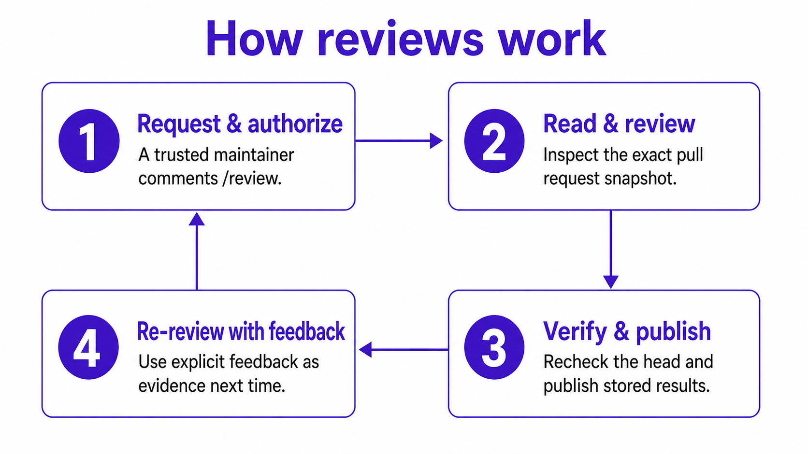

# Review Agent

Self-hosted, advisory AI code review for GitHub pull requests, built on Hermes
with deterministic controls.

[](https://github.com/CCimen/review-agent/actions/workflows/ci.yml)
[](https://github.com/CCimen/review-agent/actions/workflows/docs-pages.yml)
[](https://ccimen.github.io/review-agent/)

Deploy Review Agent once, approve a GitHub App installation, and maintainers
request reviews by commenting `/review` on a pull request. Repositories need no
workflow, secret, or local setup. Reviews are advisory: the model's tools read
the pull request and record findings in the service's database, and it has no
shell and no tool that writes to GitHub or merges.

For each request the service records the pull request's base and head commits,
lets the model read the diff and the files it asks for, checks every recorded
finding against fixed rules, and publishes the result through a separate
publisher. [How reviews work](docs/HOW_REVIEWS_WORK.md) describes each step and
which parts are code and which are the model.



## Quick start

1. **Deploy the service** with Compose, Dokploy, Coolify, Portainer,
   or Kubernetes (Helm): [deployment guide](docs/DEPLOYMENT.md).
2. **Register and install the GitHub App, then approve the installation once**:
   [GitHub App setup](docs/GITHUB_APP_PILOT.md).

   ```bash
   docker compose exec review-github-gateway \
     review-agent-admin github-app approve <installation-id> \
     --actor "github:<operator>" \
     --reason "approved organization-managed reviews"
   ```

3. **Request a review** with a new top-level pull request comment:

   ```text
   /review
   ```

Users with GitHub `write` or `admin` permission on the repository can request
reviews. Others can be allowed per repository in the console.

## Share it with other organizations

One deployment can serve several GitHub organizations. Make the App public,
send the install link, and approve each new installation; nothing is reviewed
before that approval. The other organization deploys nothing. Their code is
then processed by your deployment and model account, so read
[what is shared](docs/GITHUB_APP_PILOT.md#share-the-app-with-other-organizations)
first. An organization that wants its own data boundary runs its own deployment
with its own App.

## Use the review result

After fixing findings, push a commit and comment `/review` again. Maintainers
can answer a finding in a new top-level comment:

```text
/review false-positive F2 because <what code, guard, or invariant disproves it>
/review intentional F2 ADR-0007 because <why the accepted ADR requires this design>
/review feedback scope F2 because <why this finding is outside the intended PR scope>
/review feedback missed because <what concrete issue was missed and where>
```

See [Feedback and design decisions](docs/FEEDBACK_AND_DECISIONS.md) and a
[sanitized example review](examples/comments/example-review.md).

## What it does not do

- Gate merges. Reviews stay advisory unless your organization decides otherwise.
- Replace CodeQL, Dependabot, dependency review, tests, or type checks.
- Execute contributor code, or give the model a shell, browser, or GitHub write
  access.
- Review pull requests from forks, or start code reviews without a `/review`
  comment.

## Documentation

The [documentation site](https://ccimen.github.io/review-agent/) has search and
task-based navigation.

| You want to | Read |
| --- | --- |
| Run your first review | [Getting started](docs/GETTING_STARTED.md) |
| Understand a review step by step | [How reviews work](docs/HOW_REVIEWS_WORK.md) |
| Deploy, upgrade, or roll back | [Deployment](docs/DEPLOYMENT.md) |
| Register, approve, or share the GitHub App | [GitHub App setup](docs/GITHUB_APP_PILOT.md) |
| Hand the setup to a coding agent | [AI-assisted setup](docs/AI_ASSISTED_SETUP.md) |
| Add repository instructions, context, and decisions | [Repository context](docs/REPOSITORY_CONTEXT.md) |
| Check documentation against code changes | [Documentation review](docs/DOCUMENTATION_REVIEW.md) |
| Change the reviewer's voice or rules | [Behavior ownership](docs/BEHAVIOR_OWNERSHIP.md) |
| Add related-code lookups | [Code graph](docs/CODE_GRAPH.md) |
| Manage teams, access, model connections, sign-in, and usage | [Admin panel](docs/ADMIN_PANEL.md) |
| Operate or recover the service | [Operations](docs/OPERATIONS.md) |
| Assess trust boundaries | [Security](docs/SECURITY.md) |
| See capabilities and limits | [Capabilities](docs/ROADMAP.md) |

## Configuration

A deployment selects one reviewer profile with `REVIEW_AGENT_PROFILE`; the
shipped `default-standard` profile is neutral and not tied to an organization.
Repository-specific rules belong in the repository's optional `.review-agent/`
package. [Behavior ownership](docs/BEHAVIOR_OWNERSHIP.md) explains what a
profile can and cannot change.

The model route is set with `REVIEW_AGENT_MODEL_PROVIDER`, `REVIEW_AGENT_MODEL`,
and `REVIEW_AGENT_REASONING_EFFORT`. `REVIEW_AGENT_MODEL` is required and has no
default. Two providers are supported. The default, `openai-codex`, uses a
ChatGPT device-code login through Hermes and needs no API key; `anthropic` uses
Hermes' [Anthropic route](https://hermes-agent.nousresearch.com/docs/integrations/providers). `.env.example` lists the required values, and
[Operations](docs/OPERATIONS.md#configuration-reference) lists every variable
the Compose files read.

## Development

The runtime, admin API, and console live in this repository so API and schema
changes ship together:

```text
src/review_agent/                       the application package; start reading here
  __init__.py                           Hermes plugin entry: register() wires the model tools
  domain/                               pure values and rules
  postgres/                             PostgreSQL stores and migrations
  github/  hermes/                      everything that talks to GitHub; everything specific to Hermes
  repository_context/  code_graph/      a repository's .review-agent/ package; the optional code graph
  review/  documentation/               code-review and documentation-review use cases
  publication/  operations/             publishing a finished review; operator use cases
  tools/  console/                      the tools the review model calls; the admin console backend
  cli/                                  one module per installed command, with its loop or server
hermes/                                 what the image installs into Hermes: installer, managed configuration, patches
profiles/                               reviewer profiles
console/                                admin console frontend
tests/  scripts/                        tests, CI checks and release tooling
docs/  website/  examples/              documentation, its site, deployment templates
```

[CONTRIBUTING.md](CONTRIBUTING.md#where-the-code-lives) describes each package
inside the application and which way its imports point.

```bash
./scripts/check_bundle.sh
```

is the fast local bundle, which includes Ruff, Pyright and the unit tests. CI
runs it and also checks the installed package, the admin frontend, the
PostgreSQL contract, the images and dependency vulnerabilities. See
[CONTRIBUTING.md](CONTRIBUTING.md), and [RELEASING.md](RELEASING.md) for how
images are built, scanned, and published.

## License

Review Agent is licensed under `EUPL-1.2` (Version 1.2 only). Copyright © 2026
Çağrı Çimen and contributors. Third-party components retain their original
licenses; see [THIRD_PARTY_NOTICES.md](THIRD_PARTY_NOTICES.md).
