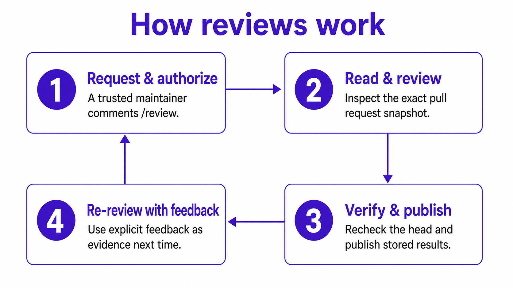

# How reviews work

The model reads code and proposes findings. Everything else is ordinary code:
who may request a review, which commits are reviewed, what is stored, and what
is written to GitHub.



## 1. Request and admission

1. Someone posts `/review` as a new top-level comment on a pull request.
2. GitHub sends the event to the admission service, which verifies the webhook
   signature and stores the delivery in PostgreSQL before answering.
3. A background worker checks the delivery through the private GitHub gateway:
   - the repository belongs to an approved installation and is enabled, or the
     installation is approved for automatic activation
     ([GitHub App setup](./GITHUB_APP_PILOT.md));
   - the commenter has current `write` or `admin` permission, or a requester
     grant in the console;
   - the pull request is open and its branch is in the same repository.
4. The run is stored with the pull request's base and head commit, and a job is
   queued.

A rejected request never reaches the model.

## 2. The reviewed snapshot

A review covers exactly one base commit and one head commit. File content is
read at those commits. Every tool call re-checks the pull request: if the head
or base moved, the run ends as superseded; if the pull request closed, the run
stops. A new `/review` starts a fresh run on the new commits.

If the repository has a `.review-agent/` package, code reads its instructions,
indexed context files, and accepted design decisions from the base commit and
stores them once per run. The reviewer receives them as untrusted input: they
can focus the review but cannot change tools, authorization, or publication.
See [Repository context](./REPOSITORY_CONTEXT.md).

## 3. What the reviewer can do

A review worker claims the job and sends one request to the model through
Hermes. The model session has only these tools:

| Tool | Purpose |
| --- | --- |
| `review_agent_begin` | Start the run; returns the overview, changed-file count, and repository guidance |
| `review_agent_pr_files` | Page through the changed-file list |
| `review_agent_pr_diff` | Read diffs, one path or a batch of paths |
| `review_agent_pr_file` | Read a file at the reviewed base or head commit |
| `review_agent_java_guidance` | Load the Java companion when Java code is in scope |
| `review_agent_related_code` | Query the optional [code graph](./CODE_GRAPH.md) |
| `review_agent_memory_context` | Read findings from earlier reviews of the same paths |
| `review_agent_memory_record` | Record findings for this run |
| `review_agent_part_report` | Read part reports in the final session of a split review |
| `review_agent_deliver` | Freeze the review for publication |

Documentation reviews use four separate tools (`review_agent_docs_begin`,
`_scope`, `_file`, `_deliver`); see [Documentation review](./DOCUMENTATION_REVIEW.md).

The session has no shell, file system, browser, web access, delegation, or
GitHub write tool. It never sees the App private key or an installation token.

## 4. The review

The review procedure is a prompt, shipped in the deployment profile. It asks
the reviewer to work in two passes inside the same session:

1. **Find candidates.** Read the diff and the surrounding code and collect
   plausible problems the pull request introduces: correctness, security,
   reliability, maintainability, and clarity.
2. **Try to disprove them.** Check each candidate against callers, tests,
   guards, and invariants, and drop what does not hold.

Security checks follow guidance adapted from
[Cloudflare's security-audit skill](https://github.com/cloudflare/security-audit-skill):
trace untrusted input across real trust boundaries and look for the control
that already prevents the problem. This is source review of one pull request,
not a full security audit.

The two passes are instructions to the model inside one session. Code does not
run a second model and cannot verify the model's reasoning. A failed attempt
can be retried, which starts a new session. What code does enforce on every
recorded finding:

- the finding is on a path changed by the pull request and is marked as
  introduced by the diff;
- it has a valid rule, category, severity, line, and fingerprint;
- confidence is at least 0.85;
- the model's publication score is at least 8 for Critical and High, and at
  least 7 for Medium and Low;
- a finding the team has marked false positive or intentional is suppressed
  while the same code context remains;
- two findings that make the same claim cannot both be published.

### Context and retrieval

By default the reviewer sees only the diff and the files it asks for. Nothing
in Review Agent reranks findings or context.

- Findings appear in a fixed order: severity, then score.
- Earlier findings are fetched by exact path, newest first.
- The optional [code graph](./CODE_GRAPH.md) is a retrieval path. It answers
  structural queries (callers, callees, references, tests) and, when OpenAI
  embeddings are enabled, a combined keyword and embedding search from the
  upstream [code-review-graph](https://github.com/tirth8205/code-review-graph)
  library. Each query returns at most ten locations in the order that library
  ranks them. Review Agent adds no ranking of its own, and the reviewer must
  read the source before using a result.

## 5. Large pull requests

Diffs are paged, so a single large file does not block the review. When the
whole diff is too large for one session, code splits the review:

1. Changed files are packed in path order into at most twelve parts, sized from
   the model's context window.
2. Each part runs as its own job and session. A part cannot report until it has
   read every diff assigned to it.
3. A final session reads every part report, checks the candidates against the
   code, removes duplicates, and delivers one review. It cannot deliver before
   it has read all reports.

A split review costs one session per part plus the final one, and takes
correspondingly longer. A file whose own diff exceeds one part, and files beyond
the twelfth part, are not read and are listed under **Coverage details**.

## 6. Coverage

Code records which diffs the tools actually returned. A path counts as covered
only when its whole diff has been returned. If GitHub's limits or a size guard
prevents that, the review says coverage is incomplete instead of reporting a
clean result. Coverage describes what was read, not how well it was understood.

## 7. Publication

`review_agent_deliver` freezes the review as rows in PostgreSQL. A separate
publisher process writes it to GitHub:

- It first confirms that the pull request still has the reviewed head commit.
  A review of an outdated commit is never posted.
- Stored findings are rendered into a summary comment, split into continuation
  comments when long.
- Up to twelve small, self-contained fixes are posted as native GitHub
  suggestions, and only when the target lines still match.
- Each written comment carries a marker. If the publisher stops after GitHub
  accepted a write, it finds the existing comment instead of posting a duplicate.

## 8. Re-reviews and feedback

Each finding gets a short reference such as `F2`, stable within the pull
request. A later review re-checks earlier findings and reports each as
resolved, still present, returned, or not checked.

Maintainers with `write` or `admin` permission can answer a finding in a new
comment:

```text
/review false-positive F2 because <what disproves it>
/review intentional F2 ADR-0007 because <why the accepted decision requires it>
/review feedback scope F2 because <why it is outside this PR>
/review feedback missed because <what was missed and where>
```

`false-positive` and `intentional` suppress that finding while the same code
context remains; `intentional` also requires the named decision to be accepted
in the repository. The two `feedback` commands record evidence for operators.
No command changes prompts or policy on its own. See
[Feedback and design decisions](./FEEDBACK_AND_DECISIONS.md).

## 9. Durability

Jobs, runs, findings, and publications live in PostgreSQL. Workers and
publishers hold leases with a generation number; a process that loses its lease
cannot write. Both can run in several replicas, and an interrupted review or
publication resumes from stored state. See [Operations](./OPERATIONS.md).

## Limits

- Reviews are advisory. They do not block merging.
- No code from the pull request is executed, and no tests are run.
- It is not a dependency or CVE scanner and does not replace CodeQL,
  Dependabot, tests, or type checks.
- It reviews the pull request, not the whole repository.
- Pull requests from forks are not reviewed.
- Code review starts only on `/review`. Only documentation review can run
  automatically.
